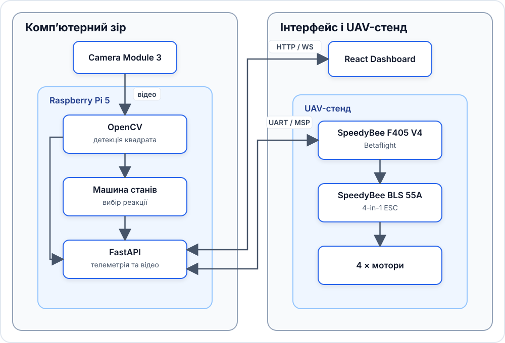
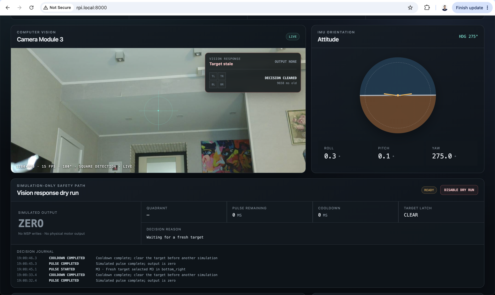
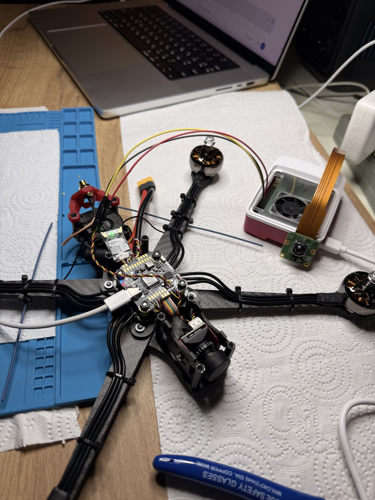
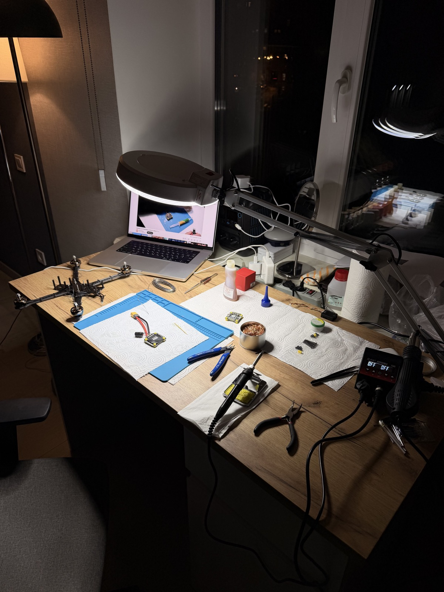
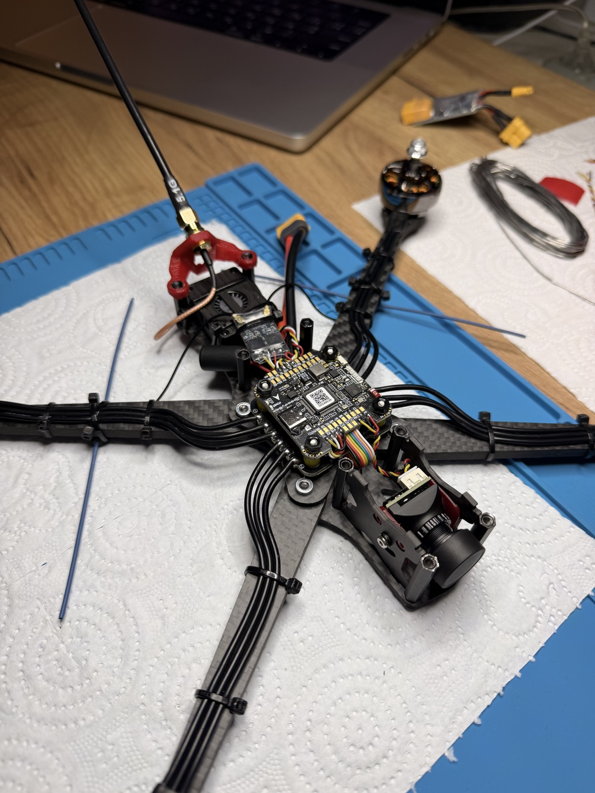
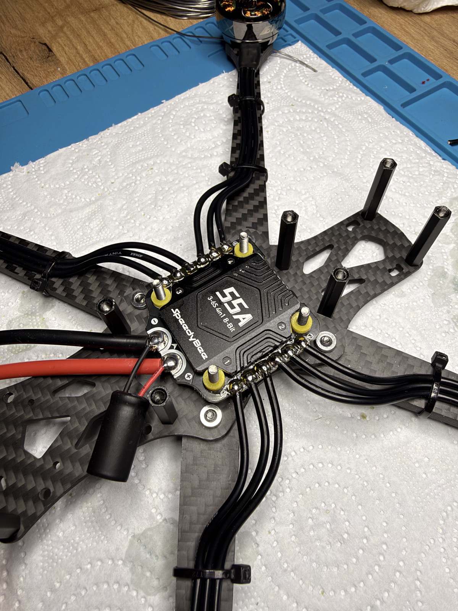

[English version →](README_EN.md)

# UAV Prototype

Навчальний UAV-прототип для дослідження комп’ютерного зору, телеметрії та реакції системи на виявлені об’єкти.

## Основна ідея

Камера передає зображення на Raspberry Pi 5, де OpenCV знаходить чорний квадрат, визначає його квадрант і в залежності від квадранта, запускає відповідний мотор. Телеметрія польотного контролера і управління системою відбувається через локальний вебдашборд.

## Архітектура

## Демонстрація

https://github.com/user-attachments/assets/2cb91d6c-d97f-4e35-8a04-a7be1e4af847

## Програмне забезпечення

| Технологія | Використання |
| --- | --- |
| Python | Комп’ютерний зір, MSP-клієнт і логіка реакції системи |
| OpenCV + NumPy | Обробка кадрів, детекція та позначення чорного квадрата |
| `rpicam-vid` | Отримання відеопотоку з Camera Module 3 |
| FastAPI + WebSockets | Локальний API, передавання телеметрії, відео та стану системи |
| React + TypeScript + Vite | Інтерфейс вебдашборда |
| Betaflight + MSP | Телеметрія та стендовий обмін даними з польотним контролером через UART |
| uv + pytest | Керування Python-залежностями й апаратно-незалежні тести |

## Апаратні компоненти

| Компонент | Модель |
| --- | --- |
| Рама | APEX HD 7″ |
| Мотори | 1300KV, 6S |
| Польотний контролер | SpeedyBee F405 V4 |
| ESC | SpeedyBee BLS 55A 4-in-1 |
| Комп’ютер | Raspberry Pi 5, 8 GB |
| CV-камера | Raspberry Pi Camera Module 3 |
| FPV-камера | Foxeer Micro Cat 4 |
| Відеопередавач | Foxeer Reaper Extreme 3W |
| Радіоприймач | BETAFPV SuperD ELRS 915/868 MHz |
| Акумулятор | 6S2P 8400 mAh, Molicel |

> Дрон зібрано за матеріалами курсу [«Народний FPV»](https://victory-drones.com/fpv).

Під час збірки ні один компонент не постраждав. Крім клавіатури ноутбука, трохи залитої флюсом.

## Галерея

  
  
   
  
  

