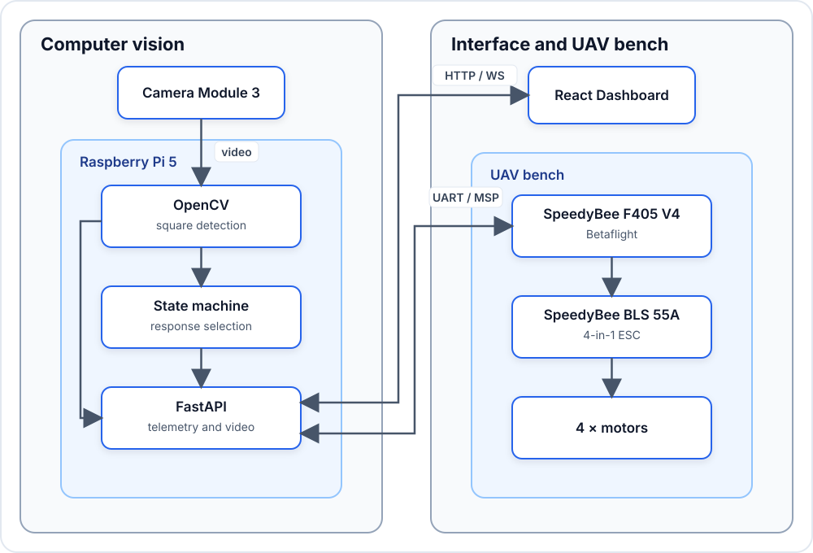
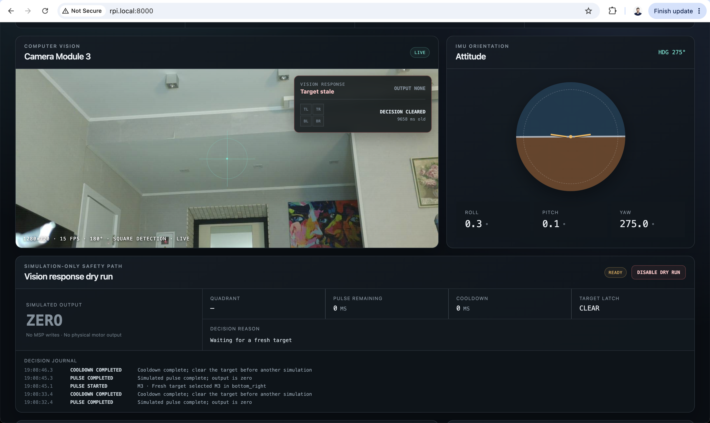
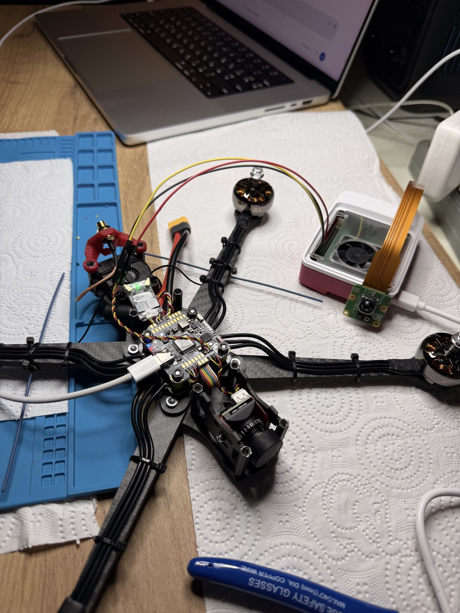
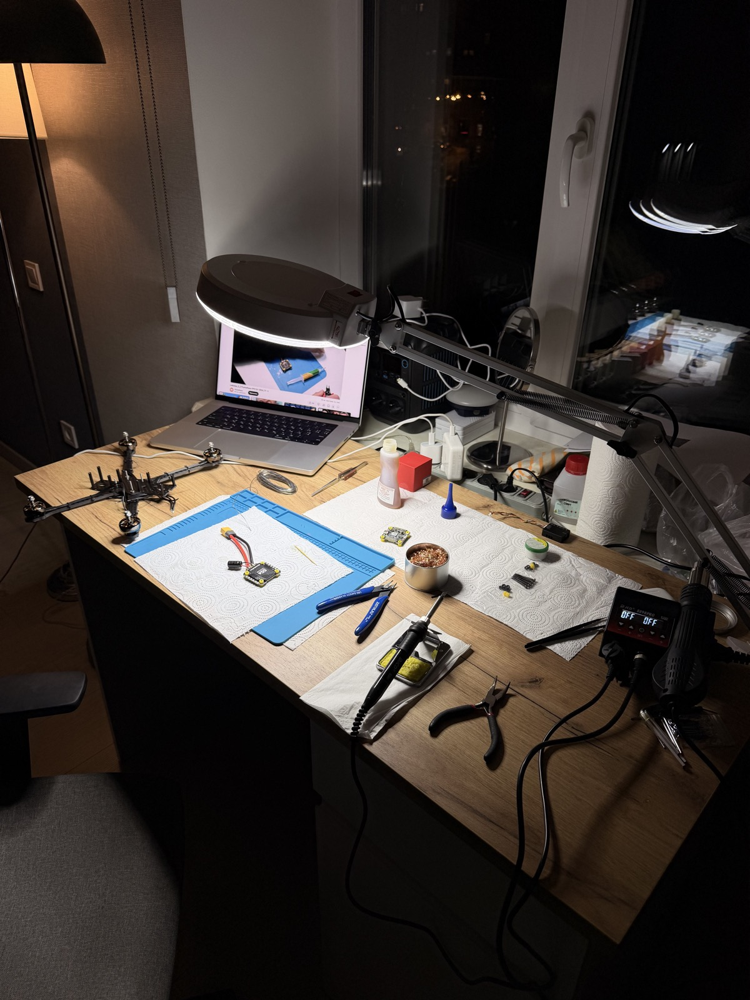
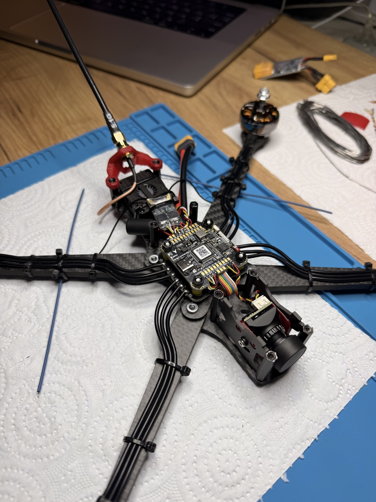
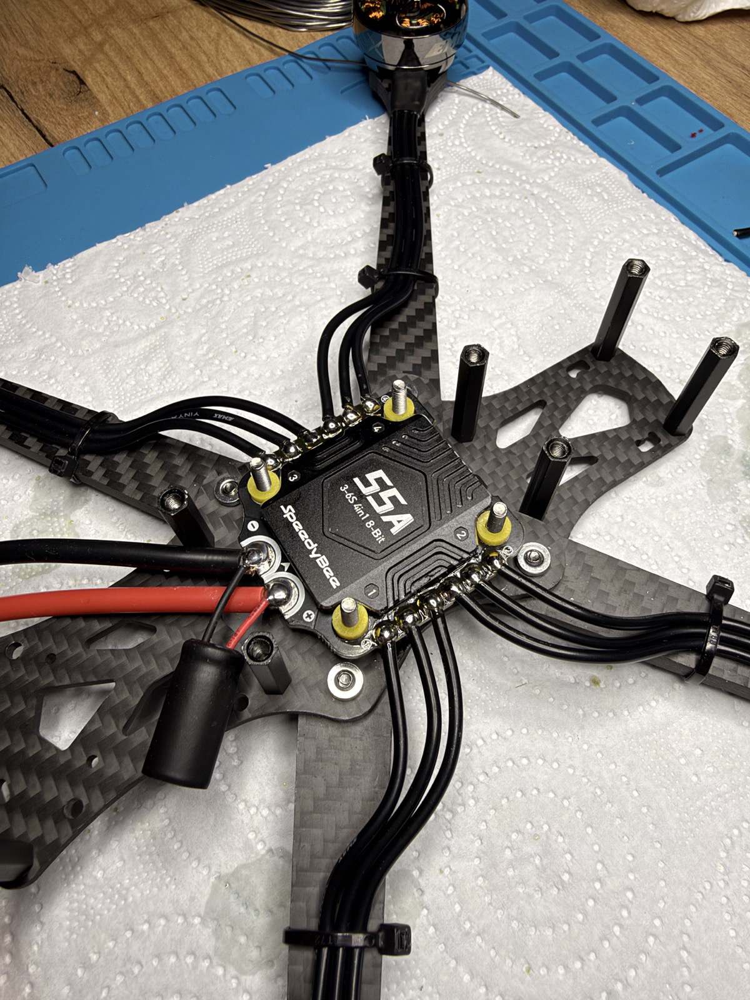

[← Українська версія](README.md)

# UAV Prototype

An educational UAV prototype for exploring computer vision, telemetry, and system responses to detected objects.

## Core idea

The camera sends video to a Raspberry Pi 5, where OpenCV detects a black square, determines its quadrant, and activates the corresponding motor. Flight-controller telemetry and system control are available through a local web dashboard.

## Architecture

## Demo

https://github.com/user-attachments/assets/2cb91d6c-d97f-4e35-8a04-a7be1e4af847

## Software

| Technology | Purpose |
| --- | --- |
| Python | Computer vision, the MSP client, and system response logic |
| OpenCV + NumPy | Frame processing and black-square detection and annotation |
| `rpicam-vid` | Video capture from Camera Module 3 |
| FastAPI + WebSockets | Local API and streaming of telemetry, video, and system state |
| React + TypeScript + Vite | Web dashboard interface |
| Betaflight + MSP | Telemetry and bench data exchange with the flight controller over UART |
| uv + pytest | Python dependency management and hardware-independent tests |

## Hardware components

| Component | Model |
| --- | --- |
| Frame | APEX HD 7″ |
| Motors | 1300KV, 6S |
| Flight controller | SpeedyBee F405 V4 |
| ESC | SpeedyBee BLS 55A 4-in-1 |
| Companion computer | Raspberry Pi 5, 8 GB |
| CV camera | Raspberry Pi Camera Module 3 |
| FPV camera | Foxeer Micro Cat 4 |
| Video transmitter | Foxeer Reaper Extreme 3W |
| Radio receiver | BETAFPV SuperD ELRS 915/868 MHz |
| Battery | 6S2P 8400 mAh, Molicel |

> The drone was assembled using materials from the [“Narodnyi FPV” course](https://victory-drones.com/fpv).

No components were harmed during assembly. Except for the laptop keyboard, which had a little flux spilled on it.

## Gallery

  
  
   
  
  

